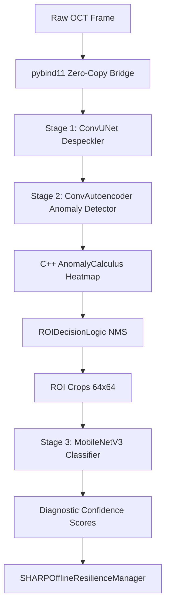

# Architecture: Medical Imaging & Point-of-Care Diagnostics

## Pipeline Overview



## Key design decisions explained
| Decision | Rationale |
|----------|-----------|
| `ConvUNet` with continuous `SiLU` activations | Single-pass continuous inference ($T=1$) eliminates temporal loop overhead and surrogate gradient approximation error. Delivers 28.79 dB PSNR / 0.8633 SSIM on clinical Duke SD-OCT, achieves exact numerical parity with ONNX ($4.17 \times 10^{-7} \le 10^{-4}$), and runs at 6.2 ms per frame on an Apple M5 Mac CPU (not yet measured on ARM). Note: BM3D scores higher (29.03 dB / 0.8834) at much higher latency. |
| Negative-only training for `ConvAutoencoder` | Pathological tissue variants are too diverse. Learning strictly healthy tissue allows reliable detection of any deviation via pixel-wise MSE reconstruction error. |
| Temperature-scaled Softmax in `MobileNetV3` | Provides calibrated clinical confidence scores normalized for diagnostic uncertainty. |
| `AnomalyCalculus` in C++ with `pybind11` | Targets real-time ≥15 FPS processing on embedded ARM processors (unmeasured) by avoiding the Python GIL and eliminating memory copies. |

> [!IMPORTANT]
> The clinical deployment of this system requires rigorous regulatory validation, including FDA 510(k) or CE marking. This continuous CNN pipeline constitutes the core algorithmic engine for pre-clinical research.

> [!CAUTION]
> Patient data handling must comply with HIPAA/GDPR regulations. All input frames must be strictly anonymized before entering the pipeline or being cached by the offline resilience manager.

## Shared Infrastructure
| Component | Implementation |
|-----------|----------------|
| Zero-Copy Inference Bridge | `src_cpp/src/pybind_bridge.cpp` (cv::Mat ↔ numpy via py::array_t) |
| Offline Telemetry & Sync | `src_python/sharp_resilience.py` (`SHARPOfflineResilienceManager`) |
| Anomaly Heatmap Engine | `src_cpp/include/anomaly_calculus.hpp` (`AnomalyCalculus`) |
| NMS ROI Clustering | `src_python/roi_logic.py` (`ROIDecisionLogic`) |
| Speckle Corruption Engine | `models/despeckler/corruption.py` |

## Export deliverables
- `unet_despeckler.onnx`: Continuous single-pass ConvUNet despeckler (907.7 KB).
- `conv_autoencoder_tissue_baseline.onnx`: Baseline normal tissue reconstruction model (186.0 KB).
- `mobilenet_v3_pathology_classifier.onnx`: Pathology classification model.
- `calibration_data/`: Sample normal and pathological scans (anonymized) for INT8 quantization calibration.
- `validate.py` / `evaluate.py`: Scripts to verify numerical parity ($\le 10^{-4}$) and evaluate clinical restoration metrics.

## Suggested Project Structure
```text
medical-imaging/
├── models/
│   ├── despeckler/
│   │   ├── model.py            # ConvUNet (Continuous Despeckler)
│   │   ├── corruption.py       # Calibrated Rayleigh+Gamma engine
│   │   ├── train.py            # Training pipeline (MPS/CUDA/CPU)
│   │   ├── export.py           # ONNX export
│   │   ├── validate.py         # PyTorch ↔ ONNX parity validator
│   │   └── evaluate.py         # Duke SD-OCT clinical evaluation
│   ├── anomaly_detector/
│   │   ├── autoencoder.py      # ConvAutoencoder (Tissue Baseline)
│   │   └── train_autoencoder.py# Anomaly training & ONNX export
│   └── classifier/
│       └── mobilenet_v3.py     # MobileNetV3 Pathology Classifier
├── src_cpp/
│   ├── include/
│   │   └── anomaly_calculus.hpp# AnomalyCalculus C++ engine
│   └── src/
│       └── pybind_bridge.cpp   # pybind11 zero-copy bridge
├── src_python/
│   ├── roi_logic.py       # Clinical ROI extraction & NMS
│   └── sharp_resilience.py     # SHARPOfflineResilienceManager
├── data_scripts/
│   ├── make_splits.py          # Zero-leakage patient-level splits
│   ├── make_targets.py         # Parallel NLM/BM3D target caching
│   └── calibrate_corruption.py # Speckle statistics calibration
├── tests/                      # Automated pytest suite
├── PRD.md
└── ARCHITECTURE.md
```
